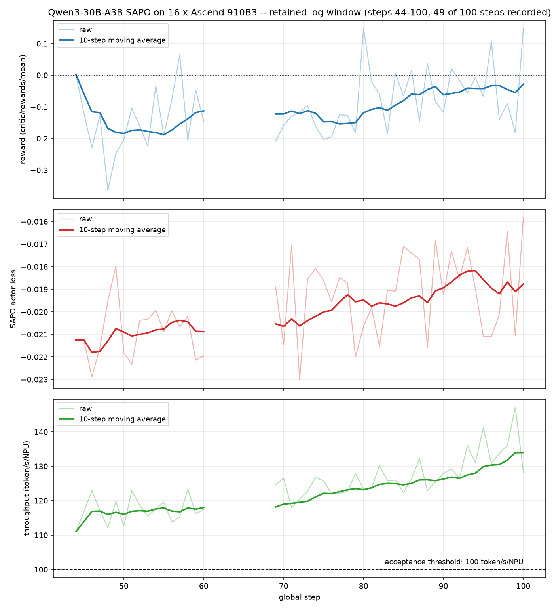

# Qwen3-30B-A3B SAPO Ascend 整体交付报告

对应任务：[verl-ascend-recipe #14](https://github.com/verl-project/verl-ascend-recipe/issues/14)

## 1. 交付概览

本交付提供 Qwen3-30B-A3B（MoE，128 experts）SAPO 在 Ascend NPU 上的可复现训练 recipe。
训练侧使用 Megatron 管理 actor 和 reference model，rollout 侧使用 vLLM-Ascend，训练入口为
`verl.trainer.main_ppo`。

| 项目 | 配置 |
| --- | --- |
| 模型 | Qwen3-30B-A3B-Base（128 experts，预转 mcore dist checkpoint） |
| 数据集 | dapo-math-17k（训练）/ AIME-2024（验证集，本次未开启在线评测） |
| 算法 | SAPO (`grpo` advantage + `sapo` policy loss) |
| 训练后端 | Megatron actor/reference |
| Rollout 后端 | vLLM-Ascend |
| 验证平台 | Atlas 800T A2，2 节点 x 8 = 16 x Ascend 910B3（HBM 60.96 GiB/卡） |
| 训练规模 | 100 global steps |
| 运行脚本 | `verl_ascend_practice/run_qwen3_30b_a3b_sapo_megatron_npu.sh` |
| 调优文档 | [`TUNING.md`](TUNING.md) |

## 2. 适配方案

SAPO（arXiv:2511.20347）用一个 tau 参数化的平滑 surrogate 取代 PPO 的比值裁剪。
通过以下配置启用：

```text
algorithm.adv_estimator=grpo
actor_rollout_ref.actor.policy_loss.loss_mode=sapo
actor_rollout_ref.actor.tau_pos=1.0
actor_rollout_ref.actor.tau_neg=1.05
actor_rollout_ref.actor.use_kl_loss=False
model_engine=megatron
```

> **tau 的正确路径是 `actor_rollout_ref.actor.tau_pos` / `.tau_neg`。**
> `tau_pos` / `tau_neg` 声明在 `ActorConfig`（`verl/workers/config/actor.py`），由
> `compute_policy_loss_sapo`（`verl/trainer/ppo/core_algos.py`）通过 `config.tau_pos` 读取。
> 若写成 `+actor_rollout_ref.actor.policy_loss.tau_pos=`，hydra 会静默新建一个从未被读取的
> 键，tau 恒为默认值，**无报错无告警**。这是本次适配中最容易踩空的一处。

recipe 通过 verl 的统一 policy-loss 调用链在 Megatron actor 中执行 SAPO objective，
并与 vLLM-Ascend rollout、math rule-based reward、权重同步和日志记录组成完整训练流程。

```text
dapo-math-17k prompts
        |
        v
vLLM-Ascend TP4 rollout (n=8 responses per prompt)
        |
        v
math rule-based reward
        |
        v
GRPO group advantage
        |
        v
SAPO policy loss (tau_pos 1.0 / tau_neg 1.05)
        |
        v
Megatron TP4 / EP8 actor update
        |
        v
weight synchronization
```

### 2.1 关键训练配置

| 配置项 | 值 |
| --- | ---: |
| train batch size | 96 |
| PPO mini batch size | 32 |
| micro batch size per NPU | 4 |
| rollout responses per prompt | 8 |
| prompt / response length | 2048 / 4096 |
| PPO max token len per NPU | 8192 |
| actor learning rate | `1e-6` |
| KL loss | 关闭（SAPO 无 KL 项） |
| entropy coefficient | 0 |
| actor TP / PP / CP / EP / ETP | 4 / 1 / 1 / 8 / 1 |
| rollout TP | 4 |
| rollout memory utilization | 0.6 |
| activation recompute | `full`（uniform，每层重算） |
| dynamic token batch | 开启（actor / rollout / ref 三处同开） |
| optimizer CPU offload fraction | 1.0（HybridDeviceOptimizer） |
| precision | BF16，`moe_router_dtype=fp32` |
| checkpoint interval | 关闭（`save_freq=-1`，见 4.1） |

actor 启用参数与梯度 offload，reference 启用参数 offload；Adam 状态通过
`optimizer_cpu_offload` 常驻 host。128 experts 的路由在 fp32 下计算，否则 Megatron 会因
数值不稳定告警。

**三个 `use_dynamic_bsz` 必须同开**：`engine_workers.py` 对 actor 与 rollout 有双向断言，
`ref` 不校验但实际必须一致。这也是吞吐超过验收线的关键项，实测贡献 +40%（见
[`TUNING.md`](TUNING.md)）。

## 3. 环境与数据准备

### 3.1 已验证软件环境

| 组件 | 版本 |
| --- | --- |
| CANN | 9.0.0 |
| Python | 3.11.15 |
| torch / torch-npu | 2.9.0 / 2.9.0.post2 |
| vLLM / vLLM-Ascend | 0.18.0 / 0.18.1.dev41 |
| Megatron Core | 0.16.2 |
| transformers | 5.3.0.dev0 |
| verl | `release/v0.8.0` |

本 recipe **不含任何 verl 源码 patch**，脚本行为完全由环境变量与 Hydra overrides 驱动。

### 3.2 数据准备

脚本通过 `TRAIN_FILE` / `VAL_FILE` 直接消费 parquet，格式为 verl 标准 RL 数据 schema。
本次长跑实际消费的两个文件：

| 文件 | 规模 |
| --- | --- |
| `dapo-math-17k/train.parquet` | 1,791,700 行（286 MB） |
| `aime-2024/test.parquet` | 960 行 |

训练集按 `train_batch_size=96` 且 drop_last 计算，1 个 epoch 约 18,663 步，本次 100 步只
消费了其中约 0.54%，因此 `TOTAL_EPOCHS=1` 配合 `trainer.total_training_steps=100` 即可。

verl 在 `examples/data_preprocess/` 下提供了 DAPO 与 AIME-2024 的预处理脚本
（`dapo_multiturn_w_tool.py`、`aime2024_multiturn_w_tool.py`，均通过 `--local_save_dir`
指定输出目录）。注意这两个脚本输出的文件名均为 `train.parquet`，与上表的 `VAL_FILE`
命名不同；本次验收未开启在线评测（`val_before_train=False`、`test_freq=-1`），验证集
不参与验收判据，替换为任意合法的 verl RL parquet 均可。

模型侧需要预先把 HF 权重转成 Megatron dist checkpoint（30B MoE 直接由 mbridge 在线加载
耗时很长）：

```bash
python3 scripts/converter_hf_to_mcore.py \
  --hf_model_path /path/to/Qwen3-30B-A3B-Base \
  --output_path /path/to/Qwen3-30B-A3B-Base-mcore \
  --use_cpu_initialization
```

转换产物约 57 GB。

## 4. 运行与恢复

在 verl 根目录执行：

```bash
export DATA_ROOT=/path/to/data

DEVICE=npu INFER_BACKEND=vllm \
MODEL_PATH=/path/to/Qwen3-30B-A3B-Base \
MCORE_MODEL_PATH=/path/to/Qwen3-30B-A3B-Base-mcore \
TRAIN_FILE="${DATA_ROOT}/dapo-math-17k/train.parquet" \
VAL_FILE="${DATA_ROOT}/aime-2024/test.parquet" \
NNODES=2 NDEVICES_PER_NODE=8 \
TP=4 PP=1 CP=1 EP=8 ETP=1 GEN_TP=4 \
RECOMPUTE=full OPTIMIZER_OFFLOAD_FRACTION=1 \
TAU_POS=1.0 TAU_NEG=1.05 \
TRAIN_BATCH_SIZE=96 PPO_MINI_BATCH_SIZE=32 PPO_MICRO_BATCH_SIZE_PER_GPU=4 \
MAX_PROMPT_LENGTH=2048 MAX_RESPONSE_LENGTH=4096 PPO_MAX_TOKEN_LEN_PER_GPU=8192 \
ROLLOUT_N=8 ROLLOUT_GPU_MEM_UTIL=0.6 SAVE_FREQ=-1 \
bash /path/to/verl-ascend-recipe/verl_ascend_practice/run_qwen3_30b_a3b_sapo_megatron_npu.sh \
    trainer.total_training_steps=100 \
    actor_rollout_ref.actor.use_dynamic_bsz=True \
    actor_rollout_ref.rollout.log_prob_use_dynamic_bsz=True \
    actor_rollout_ref.ref.log_prob_use_dynamic_bsz=True
```

模型、数据、设备数、并行度、batch、长度、checkpoint 和 profile 开关均可通过环境变量覆盖；
额外参数会作为 Hydra overrides 继续传递给 `verl.trainer.main_ppo`。

### 4.1 关于 checkpoint

本次长跑使用 `SAVE_FREQ=-1`，**全程不落盘，因此没有产出可加载的 checkpoint**。这是一个
有意的规避，而非疏漏：在 verl `v0.8.0` 上，同配置的一次早期长跑在第 100 步落盘时死于
`megatron_checkpoint_manager.py` 中的 30 分钟 gloo barrier 超时，且 `async_save` 路径在该
版本下会产出不可加载的产物。两个问题的定位、根因与候选修复见
[`TUNING.md`](TUNING.md) 第 6.4 节。

因此 `trainer.resume_mode=auto` 的断点续训路径在本 recipe 中**未经验证**。若要开启
checkpoint，请先阅读 `TUNING.md` 第 6.4 节的冒烟验证清单。issue #14 的验收口径
（reward 上升 + TPS）不依赖末态 checkpoint。

## 5. 100-step 长跑结果

本次训练在 2 节点 x 8 = 16 x Ascend 910B3 上连续完成 **100/100 global steps**，任务状态
`Succeeded`，训练主循环用时约 12 小时 48 分钟（07:51:55 → 20:52:05），双节点
`exit code: 0`，全程无 OOM、无算子错误、无通信异常、无 AssertionError、无 gloo timeout。

> **指标窗口说明**：集群保留的日志窗口覆盖 **step 44–100 中的 49 个 step**（61–68 这 8 个
> step 的指标行不在保留窗口内），step 1–43 的指标行已滚出留存期。下表所有统计量均在这
> 49 个 step 上计算，而非全部 100 个 step。曲线图同样只绘制这 49 个点，缺失区间以断线
> 表示，不做插值。

| 指标 | 结果 |
| --- | ---: |
| 连续训练步数 | 100 / 100（任务 `Succeeded`） |
| 指标样本数 | 49（step 44–100 保留窗口） |
| `critic/rewards/mean` 首 10 步均值 | -0.1779 |
| `critic/rewards/mean` 末 10 步均值 | -0.0284 |
| reward 首尾窗口增量 | +0.1495 |
| reward 线性斜率 | +0.003350 / step |
| `actor/loss` 首 10 步均值 | -0.020933 |
| `actor/loss` 末 10 步均值 | -0.018761 |
| `actor/grad_norm` 均值 | 0.1692（min 0.1050 / max 0.5839） |
| 平均 step 时间 | 456.0143 s |
| 平均吞吐 | 124.0365 token/s/NPU |
| 16 NPU 实测总吞吐均值 | 1984.58 token/s |
| 吞吐最小值 | 110.9802 token/s/NPU（step 44） |
| actor 峰值分配显存 | 29.2208 GiB/NPU（60.96 GiB 的 48%） |

### 5.1 长跑曲线

下图覆盖保留窗口内的 49 个 step，依次展示 `critic/rewards/mean`、SAPO `actor/loss` 和
`perf/throughput`。三项指标均保留原始值和 10-step moving average；吞吐面板另外
标出 issue #14 在无 GPU 标杆时的 100 token/s/NPU 验收线。



reward 在 GRPO 分组优势下围零振荡，10-step 移动平均全程向零抬升；SAPO `actor/loss` 是
policy optimization objective，允许随 batch 和 advantage 分布波动，49 个样本均为有限值。
吞吐在窗口内缓慢上行，与 response length 的分布变化一致。

### 5.2 性能与稳定性

- `critic/rewards/mean` 末 10 步均值比首 10 步提高 0.1495，线性斜率 +0.003350/step，整体趋势上升。
- 49 个吞吐读数**全部 > 100 token/s/NPU**，均值 124.0365，最低 110.9802（step 44）；
  16 NPU 实测总吞吐均值 1984.58 token/s，高于任务在无 GPU 标杆时要求的 100 TPS。
- `actor/perf/max_memory_allocated_gb` 在整个窗口内恒为 29.2208 GiB，无增长、无泄漏。
- 训练主循环连续完成 100 steps，在 `is_last_step` 正常返回退出，而非超时崩溃。
- `actor/loss`、`actor/grad_norm`、reward、step time 和 throughput 在保留窗口内均为有限值。

## 6. 复现证据与验收结论

第 5 节的全部统计量由验收任务 `716535` 的训练日志解析得到，曲线图亦由同一份日志渲染，
未做任何平滑以外的加工。日志取回方式：

```bash
cctl pytorchjob logs 716535 --pod all --no-input
```

| Issue #14 验收项 | 本次结果 |
| --- | --- |
| 完成 100 steps 或运行 12 小时 | 两项同时满足：连续 100/100 steps，用时约 12 小时 48 分钟 |
| reward 上升 | 首 10 步均值 -0.1779，末 10 步均值 -0.0284（+0.1495） |
| 无 GPU 标杆时 TPS > 100 | 49 个读数全部 > 100，均值 124.0365 token/s/NPU |
| 提供算法适配调优文档 1 篇 | [`TUNING.md`](TUNING.md)（适配踩坑、6 组探针、算子级 profile、失败根因） |
| 提供可复现 recipe | 提供模型、数据、环境、启动和日志配置；checkpoint/resume 未验证，原因见 4.1 |

本次结果满足 Issue #14 在无同版本 GPU 标杆时的效果和性能验收标准，并提供了
Qwen3-30B-A3B SAPO 在 Megatron + vLLM-Ascend 组合上的完整复现入口。

**已知局限**（同样记录在 `TUNING.md`）：

1. checkpoint 落盘在 verl `v0.8.0` 上有未修复的隐患，本 recipe 以 `SAVE_FREQ=-1` 规避，
   未产出可加载 checkpoint，断点续训未验证。
2. 集群日志留存期导致 step 1–43 与 61–68 的指标行缺失，第 5 节统计基于 49 个保留样本。
3. 未做同版本 GPU 标杆对比，性能按 issue #14 的绝对 TPS 口径验收。
